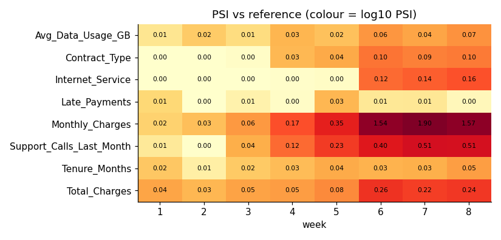
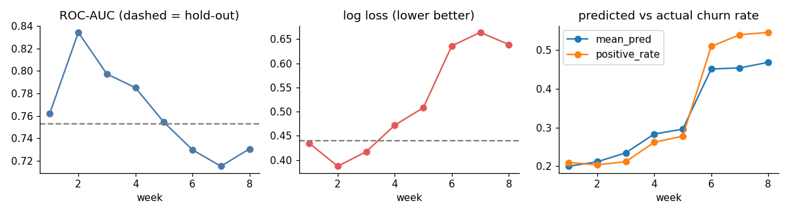
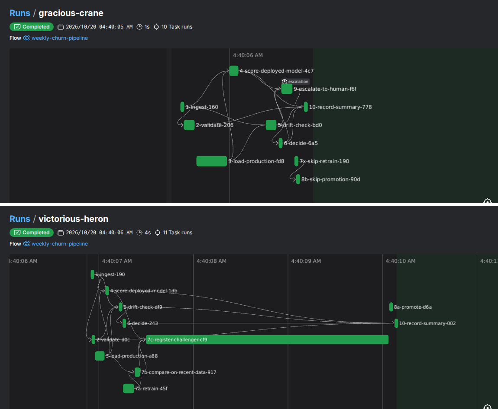
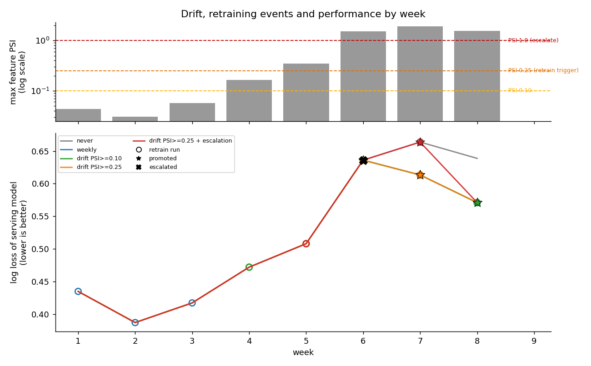

**Stack (all free/open source, local):** MLflow (registry) · Prefect 3 (orchestration, replaces Step Functions) · functions-framework (replaces Lambda) · scikit-learn · own PSI/KS code cross-checked with Evidently (replaces Model Monitor) · pytest. Repo: `churn-mlops/` (README, `configs/pipeline_config.json`, `evidence/`).

## 1. Baseline and registry (Task 1)
Scaled one-hot **logistic regression**, trained on a fixed 75% split of the reference file; hold-out ROC-AUC 0.753, PR-AUC 0.469, log loss 0.440, F1 0.469 (threshold 0.35, churn 20.6%). A boosted tree scored 0.91 ROC-AUC in-sample but 0.72 on hold-out, so the simpler model was kept. **Metric choice:** with ~20% positives accuracy is uninformative, so I report PR-AUC/F1, but monitor with **ROC-AUC and log loss** because churn later rises to 51-55%, which inflates PR-AUC/F1 mechanically. Reproducible: two independent runs gave identical metrics (`reproducibility_check.json`; fixed seeds and split). Registered as `churn-model` v1 with parameters, metrics, `evaluation.json` and a **reference profile** (decile bin edges, means/SDs, category frequencies, missing rates, 1,500-row sample for KS); alias `production` -> v1 (`evidence/mlflow_registry_*.png`, `registry_export.json`).

## 2. Serverless endpoint (Task 2)
`function/main.py` takes `{"instances":[...]}` and returns probability, label and `model_version` (HTTP 400 with the missing fields on bad input). **Model selection mechanism:** it resolves the registry alias `production`, re-checking it at most every 2 s and reloading only when the version number changes; promotion moves the alias, so no code is rewritten or redeployed. If the registry is unreachable, a warm instance keeps serving its last good model. Live demonstration (`logs/endpoint_promotion_demo.log`): the same probe returned v1 / p=0.8515 through week 6 and v3 / p=0.8133 after week 7's promotion, with no restart.

| local latency (ms) | n | p50 | p95 | mean |
|---|---|---|---|---|
| cold (fresh process: imports + registry lookup + model load + first call) | 30 | 2,664 | 3,092 | 3,162 |
| warm (initialised instance) | 200 | 6.2 | 8.1 | 6.5 |

Cold is ~430x warm: about 2.3 s is importing MLflow/scikit-learn and 0.8 s is the first registry lookup and model load; warm calls only run the in-memory model. In a real cloud function the fixes are lazy imports, a lighter model format, and minimum instances. These are local-process numbers, not cloud measurements.

## 3. Drift investigation (Task 3, notebook `03_drift_investigation.ipynb`)
**Measures:** PSI per feature against the stored profile (10 reference-decile bins for numeric, category frequencies for categorical; <0.10 stable, 0.10-0.25 moderate, >0.25 major - the conventional bands) and the KS statistic for numeric features. With 500 rows a week, no-drift weeks 1-3 give PSI up to 0.06, so 0.10 is above the noise floor. **Performance:** ROC-AUC and log loss of the *baseline v1* on each week; I call it a loss when log loss is >15% above its weeks 1-3 level (0.39-0.44) or ROC-AUC falls clearly below the hold-out value.

**Cross-check with Evidently** (`evidently_crosscheck.py`): its PSI agrees with mine on the weekly drift flag at the 0.25 trigger in all 8 weeks, and on 6 of 8 weeks for the most-drifted feature (the 2 that differ are no-drift weeks 1-2); rank correlation over all 64 feature-weeks is 0.96. Magnitudes differ in severe weeks (week 6 Monthly_Charges 2.4 vs my 1.5) because of binning, but both are far above 1.0, so the escalation rule fires in the same weeks under either implementation. Evidently's default tests flag 6 of 8 features as drifted in week 6 (`evidence/evidently_week6_drift_report.png`).

Weeks 1-3: no drift (max PSI 0.03-0.06). Week 4: Monthly_Charges 0.17, Support_Calls 0.12. Week 5: 0.35 and 0.23. Weeks 6-8: step change - Monthly_Charges 1.5-1.9 (mean +$26), Support_Calls 0.40-0.51, Total_Charges 0.22-0.26, Contract/Internet mix 0.09-0.16; Tenure, Late_Payments and data usage stay stable; missing rates and categories are unchanged, so it is not a data-quality problem. It is **also concept drift**: within each segment churn is much higher in weeks 6-8 (two-year contracts 45% vs 7%, one-year 55% vs 15%, Fiber 72% vs 34%) and the month-to-month coefficient falls from 1.08 to 0.09.

| weeks | drift (max PSI) | baseline ROC-AUC / log loss | verdict |
|---|---|---|---|
| 1-3 | none (≤0.06) | 0.76-0.83 / 0.39-0.44 | healthy |
| 4-5 | moderate → major (0.17, 0.35) | 0.79, 0.75 / 0.47, 0.51 (+14%, +23% vs wk 1-3 mean 0.41) | **drift, little damage**: week 4 within noise (+14% < 15% rule); week 5 mild loss in log loss (+23%) while ROC-AUC is at its hold-out level |
| 6-8 | severe (1.5-1.9) | 0.72-0.73 / 0.64-0.66 (+54-61%); predicts 45% churn vs 51-55% actual | **drift and real loss** |

So drift and performance loss do not always coincide: weeks 4-5 raise alarms with little loss. The reverse (loss without drift) did not occur; week-to-week ROC-AUC noise at n=500 is about ±0.04 (95% bootstrap half-width 0.038 on one week; e.g. week 2 = 0.83), which is why log loss and calibration are used alongside AUC.

## 4. Orchestrated workflow (Task 4)
One Prefect flow run per week: ingest → validate → load production → score deployed model → drift check → **decide** → {retrain → compare on recent data → register → promote or skip} | {escalate and stop} | {no action} → record summary. Skipped branches are explicit tasks (`7x-skip-retrain`, `8b-skip-promotion`), so every run's graph shows what happened (below: week 6 escalation, week 7 retrain and promote; 8-week run history in `evidence/run_history_table.png` and `prefect_run_history.png`).

| week | max PSI | drift? | retrained | promoted | production | note |
|---|---|---|---|---|---|---|
| 1-3 | 0.04, 0.03, 0.06 | no | no | no | v1 | |
| 4 | 0.17 | below 0.25 trigger | no | no | v1 | |
| 5 | 0.35 | yes | yes | no | v1 | challenger gain 0.8% < 2% gate; registered as v2 |
| 6 | 1.54 | yes | **no** | no | v1 | **ESCALATED** (PSI ≥ 1.0), pipeline paused |
| 7 | 1.90 | yes | yes | **yes** | v1 → v3 | human-approved; log loss 0.642 → 0.586 (-8.7%) |
| 8 | 0.11 | no (new profile) | no | no | v3 | |

**No look-ahead:** the week-N run reads only weeks 1..N (`ingest` raises `LookAheadError` otherwise; tested, F7). Each batch is split 60/40; challengers train on reference-train (weight 0.25) plus the 60% halves of the last 3 weeks and are compared with production on the 40% halves of the last 2 weeks, which no model trained on. **Gate:** log loss ≥2% better *and* ROC-AUC no more than 0.01 worse. Production changes only through the gated `promote` task.

## 5. Retraining policy study (Task 5)
Same decision code simulated per policy; week N is served by the model chosen with data up to N-1. Weekly log loss of the serving model (R = retrain run, P = retrain and promoted, E = escalated):

| policy | wk1 | wk2 | wk3 | wk4 | wk5 | wk6 | wk7 | wk8 | retrains |
|---|---|---|---|---|---|---|---|---|---|
| never retrain | .435 | .387 | .417 | .472 | .508 | .636 | .664 | .639 | 0 |
| every week | .435R | .387R | .417R | .472R | .508R | .636P | .613P | .571P | 8 |
| drift, PSI ≥ 0.10 | .435 | .387 | .417 | .472R | .508R | .636P | .613P | .571P | 5 |
| drift, PSI ≥ 0.25 | .435 | .387 | .417 | .472 | .508R | .636P | .613P | .571 | 3 |
| drift ≥ 0.25 + escalation (PSI ≥ 1.0) | .435 | .387 | .417 | .472 | .508R | .636E | .664P | .571 | 2 |

**Cost assumption (USD, stated, adjustable):** missed churner 200, false alert 20 (retention offer), retraining run 50 (compute + validation + review). Total 8-week cost, and sensitivity to the cost of one retraining run:

| policy | mean ROC-AUC | mean log loss | wk 6-8 log loss | cost @ $50/run | @ $500 | @ $2,000 | @ $5,000 |
|---|---|---|---|---|---|---|---|
| never retrain | 0.764 | 0.520 | 0.646 | 104,460 | 104,460 | 104,460 | 104,460 |
| every week | 0.772 | 0.505 | 0.607 | 97,080 | 100,680 | 112,680 | 136,680 |
| drift ≥ 0.10 | 0.772 | 0.505 | 0.607 | 96,930 | 99,180 | 106,680 | 121,680 |
| **drift ≥ 0.25** | 0.772 | 0.505 | 0.607 | **96,830** | 98,180 | 102,680 | 111,680 |
| drift ≥ 0.25 + escalation | 0.769 | 0.511 | 0.624 | 99,700 | 100,600 | 103,600 | **109,600** |

**Recommendation:** drift-triggered retraining at **PSI ≥ 0.25 with the promotion gate**. Never retraining is clearly worst (log loss 6% higher in weeks 6-8, +$7.6k). Weekly and both drift policies end with the same model quality, but drift-triggered needs 3-5 retrains instead of 8 - and the gate rejected the week-4/5 challengers anyway, so those retrains bought nothing - so it is cheaper at every retraining cost I tested and the gap widens (at $2,000 a run, weekly retraining costs $10k more). I recommend adding the escalation rule as a safety layer: it costs $2.9k (3%) at $50/run because the pipeline waits a week for a human on the abrupt shift, and it becomes the cheapest policy once a run costs more than about $2,900 (break-even; $109.6k vs $111.7k at $5,000). Caveat: 500 rows/week, one deterministic run - differences of a few percent between the retraining policies are within noise; only never vs. any is clear.

## 6. Failure handling (Task 6; `logs/fault_injection.log`)
Run in an isolated registry; after each case the production version and the endpoint's prediction were compared before/after. **Retry configuration is deliberate:** schema validation has *no* retry (a corrupt file will not fix itself); registry and I/O calls retry only on `ConnectionError/TimeoutError/OSError` with 1-2-4 s backoff (3 retries; ingest 2 retries, 2 s).

| injected fault | behaviour | production / endpoint |
|---|---|---|
| corrupt batch (column dropped) | fails at validate in 0.05 s, no retry: `missing columns: ['Total_Charges']` | v1, p=0.8515 unchanged |
| registry flaky (2 timeouts) | retried, run succeeds | unchanged |
| registry down (permanent) | 3 retries (7.1 s) then FAILED, clear error | unchanged |
| worse challenger (shuffled labels) | registered, **gate rejects** | unchanged |
| registry write fails at registration | retries then FAILED (7.7 s), alias untouched | unchanged |
| 2 rejected challengers in a row, drift persists | next run **escalates**, no automatic retrain | unchanged |
| week-4 data requested in a week-3 run | `LookAheadError` | n/a |

## 7. Escalation design (Task 7)
**Condition (implementable from this text):** at the end of validation and drift checking for week N, with *drift* defined as max feature PSI ≥ 0.25 against the production model's stored profile, the pipeline **stops** (no retrain, no promotion) and escalates if **(a)** max PSI over all features ≥ 1.0, **or (b)** drift is present and the last 2 gated challengers both failed the gate. It then writes `escalations.jsonl` (week, reasons, per-feature PSI, deployed-model metrics), logs `ESCALATION_TRIGGERED` at CRITICAL, publishes a Prefect artifact and sets state *paused*; it resumes only when a human decision for that week exists in `configs/human_decisions.json` (approve gated retrain / reject).
**Fired in the 8-week run:** week 6, max PSI 1.54 on Monthly_Charges (`escalations.jsonl`, `evidence/prefect_graph_week6.png`); the human step was *simulated* by the driver script and the approved retrain still had to pass the gate. Rule (b) did not fire in the real weeks (week 5 was the only rejected challenger) but fired in fault test F6.
**Why 1.0, from the numbers:** Task 3: weeks 1-5 have max PSI ≤ 0.345, weeks 6-8 are 1.54-1.90; week 6 also shows churn 28% → 51% and log loss +25% (0.51 → 0.64). Task 5, rerunning the policy with different thresholds:

| escalation PSI | weeks escalated | retrains | promotions | wk 6-8 log loss | cost |
|---|---|---|---|---|---|
| 0.25 (stricter) | 5, 7 | 2 | 2 | 0.613 | 98,740 |
| 0.5 or 1.0 | 6 | 2 | 1 | 0.624 | 99,700 |
| 2.0 (looser) | none | 3 | 2 | 0.607 | 96,830 |

A stricter bar (0.25) also escalates week 5, where the gated automatic path had *already* rejected a challenger (gain 0.8%) - an unnecessary page - and again in week 7. A looser bar (2.0 > max observed 1.90) never fires, so the abrupt shift is handled with no human review. Any value between 0.35 and 1.5 behaves identically on this data; I chose 1.0 because it is 2.9x the largest benign-period value (0.345), has 35% margin below the smallest severe week (1.54), and is four times the conventional "major" PSI of 0.25. **Honest limit:** the data cannot distinguish 0.5 from 1.0, and escalation costs about 3% here; its value is risk control, not average cost.

## Limitations
22 pytest tests (`tests/`) enforce the no-look-ahead guard, validation, promotion gate, escalation rule and reproducibility. Local execution (no cloud deployment or cloud latency; the `Dockerfile` and CI file were written but not run in my sandbox); human decision simulated; labels assumed available in the same week; 500-row weeks and a single deterministic run.
